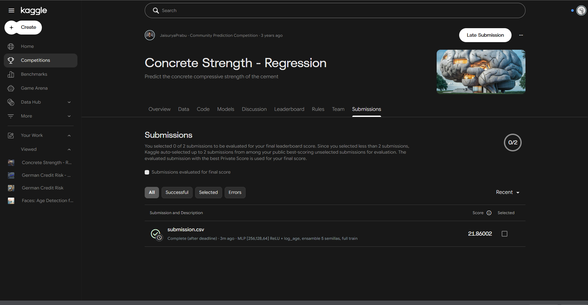

# Workshop 2 — MLP desde cero en PyTorch: resistencia del concreto

**Curso:** ST1613 Applied Machine Learning — EAFIT  
**Integrantes:** Tomás Echavarría Gil · Daniel Arango  
**Competencia:** [Concrete Strength Regression (Kaggle)](https://www.kaggle.com/competitions/concrete-strength-regression)

Red neuronal fully connected implementada desde cero en PyTorch para predecir la resistencia a la compresión del concreto (`csMPa`, MPa) a partir de su composición y edad. Métrica oficial: **MSE**.

## Estructura

```
├── workshop2.md            # Enunciado
├── DEVELOPMENT-PLAN.md     # Plan de trabajo
├── requirements.txt
├── data/                   # CSV de Kaggle (no versionados)
├── reference/              # Notebooks de clase (MNIST, ASL)
├── notebooks/              # Notebook principal del taller
├── submissions/            # submission.csv
└── reports/                # Figuras y pantallazo de Kaggle
```

## Cómo reproducir

1. Descargar `train.csv`, `test.csv` y `sample_submission.csv` de la competencia en `data/`:
   ```bash
   kaggle competitions download -c concrete-strength-regression -p data
   ```
   (descomprimir si llega como `.zip`).
2. Instalar dependencias:
   ```bash
   python -m venv .venv
   source .venv/Scripts/activate        # PowerShell: .venv\Scripts\Activate.ps1
   pip install torch --index-url https://download.pytorch.org/whl/cpu
   pip install -r requirements.txt
   ```
3. Abrir `notebooks/workshop2_concrete_mlp.ipynb` y ejecutar *Restart & Run All*.

## Resultados

| Modelo | MSE CV (5-fold, MPa²) | MSE Kaggle (MPa²) |
|---|---|---|
| Baseline: predecir la media | 296.4 ± 35.4 | — |
| Baseline: LinearRegression (con feature engineering) | 50.5 ± 10.9 | — |
| MLP base [128, 64, 32] ReLU | 18.9 ± 3.6 | — |
| Mejor MLP [256, 128, 64] ReLU + `log1p(age)`, modelo único | 17.35 ± 1.48 | — |
| **Mejor MLP, ensamble de 5 semillas (submission)** | **15.84 ± 2.36** | **21.86** |

El MSE en Kaggle (RMSE ≈ 4.7 MPa, R² ≈ 0.93) resultó mayor que el estimado por validación cruzada. El análisis de esa brecha está en la sección 7.5 del notebook y las conclusiones en la sección 8.


